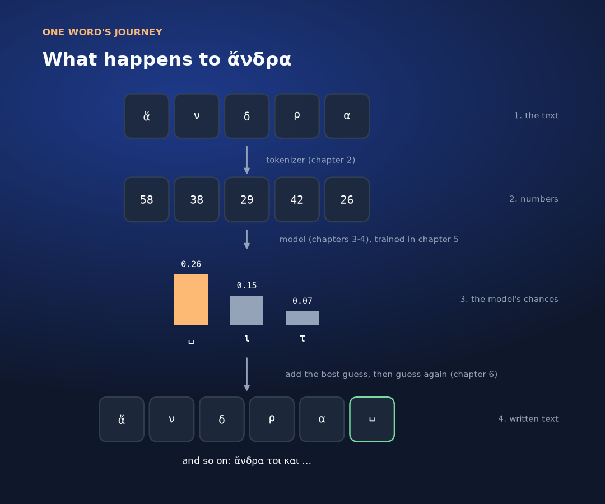
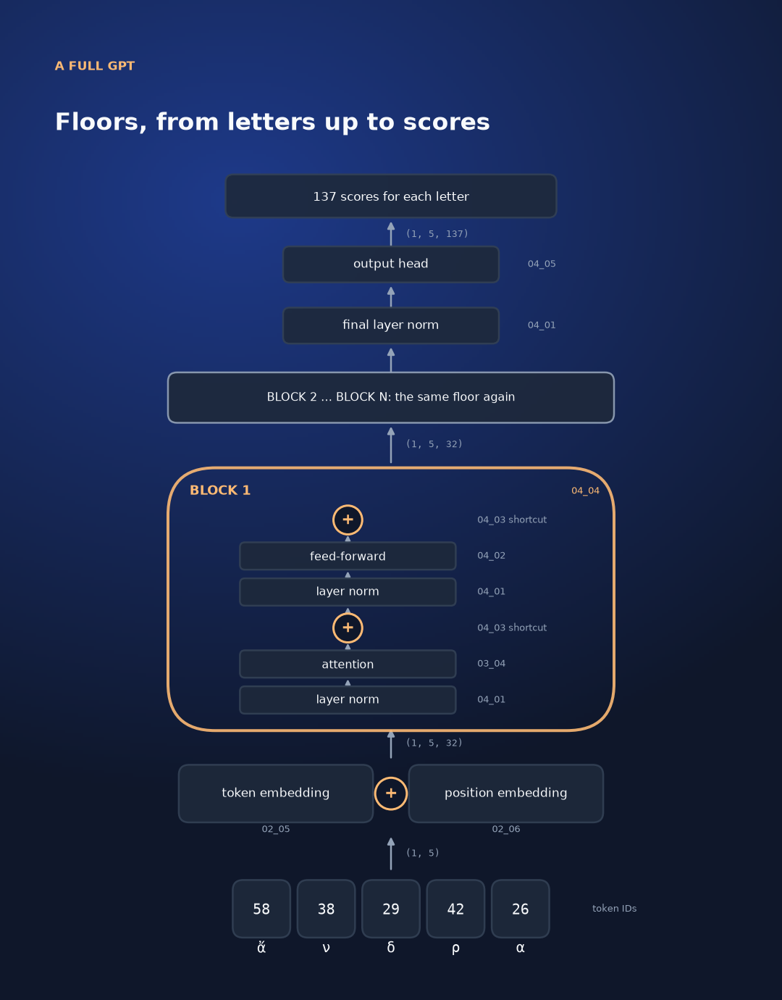
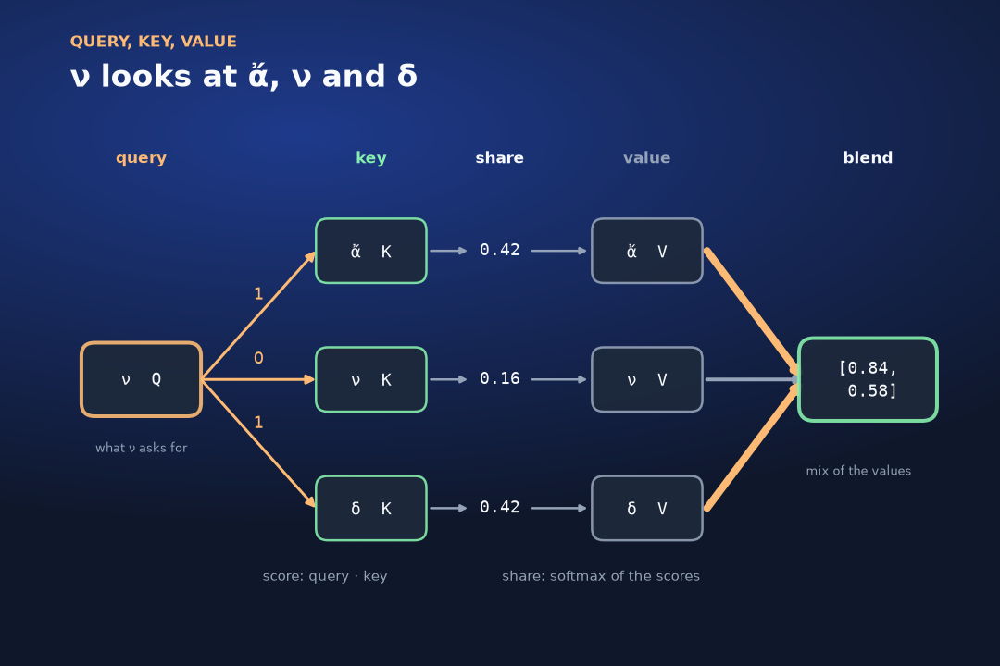
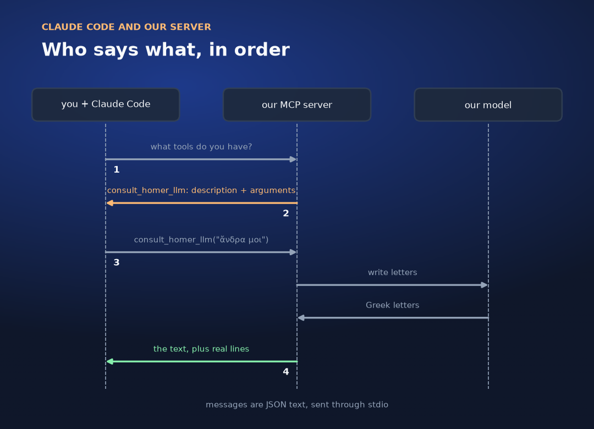

# homer-ai

**Build your own large language model from scratch, on Homer's Greek, on your own computer.**

A course for developers who are new to machine learning. You build a small model that reads Homer's *Odyssey* and writes Greek that sounds a bit like it.
Then you let other AI apps, like Claude, ask **your** model for text. No GPU needed.

[](notebooks/00_start_here/00_00_course_map.ipynb)

*One Greek word, `ἄνδρα`, on its way through the model. The pictures in the notebooks look like this. Click it to open the notebook that draws it.*

## Quick start

```
git clone https://github.com/IcodeNet/homer-ai && cd homer-ai && uv sync # the clone is small; uv sync downloads PyTorch and the other libraries (about 900 MB, first time only)
code .                                                      # opens the folder in VS Code (say yes to its suggested extensions)
# then open notebooks/00_start_here/00_00_course_map.ipynb and pick the .venv kernel
```

The clone itself is small, a few MB: the code, the Greek text and the ready-made models. `uv sync` is the big step. It downloads PyTorch and the other libraries
into a folder called `.venv` inside the project, about 900 MB, and only the first time. `.venv` is never committed to git.

You need three free tools first: [VS Code](https://code.visualstudio.com/), [git](https://git-scm.com/) and [uv](https://docs.astral.sh/uv/).
Stuck? The [FAQ](docs/FAQ.md) walks you through setup and troubleshooting, step by step.

**The one rule:** open the notebooks in number order. The milestones below are just checkpoints along the way.

## ❓ What does the model achieve?

Loss tells you how wrong the model's guess for the next letter is, on average. Lower is better ([05_01](notebooks/05_training_on_the_odyssey/05_01_loss_and_epochs.ipynb) explains it properly). Here's what we get on Odyssey Book 1:

| Guesser | Loss |
|---|---|
| Random guess among 137 characters (`ln 137`) | 4.92 |
| Bigram (counts which letter follows which), in-sample, all of Book 1 | 2.88 |
| Bigram, held-out: counted on the first 90%, scored on the last 10% (add-one smoothing) | 2.99 |
| Small one-head model (`models/odyssey_book1.pt`), in-sample, all of Book 1 | 2.38 |
| **The GPT of chapter 4** (`models/odyssey_book1_gpt.pt`), **held-out**: trained on the first 90%, scored on the last 10% | **2.27** |
| The GPT, in-sample: the first 90% it trained on | 1.51 |

Careful how you read this. The small model was trained on all of Book 1, so its 2.38 is in-sample: measured on text it has already seen. That's not a fair comparison with the held-out rows.
The GPT only trained on the first 90%, so its **2.27 is a fair held-out number**. It beats the bigram's 2.99 and is far better than random guessing. But look at the gap to its in-sample 1.51: it's still memorising some of Book 1.
The GPT also repeats itself less than the small model ([06_02](notebooks/06_making_it_talk/06_02_less_repetition.ipynb)). It doesn't write real sentences, though. [05_05](notebooks/05_training_on_the_odyssey/05_05_validation.ipynb) has the held-out check.
You can reproduce the table with `uv run python scripts/baselines.py` (it trains nothing and writes nothing), and train your own GPT with `uv run homer-train --model gpt` (about 3 minutes on a laptop).

## ❓ Who is this for?

You're a working developer. You know some language well (it doesn't have to be Python), but you've never done machine learning.
School maths is enough, even if it's rusty: matrices, `e` and logarithms get a gentle introduction. You want to understand
how LLMs work, build one from scratch, and maybe move into AI engineering. Everything runs on a laptop CPU, in short sessions.
We explain the AI and the PyTorch, not general programming. If Python is new to you, [A_01](notebooks/A_toolbox/A_01_python_essentials.ipynb) is an optional primer.

## ❓ What will I build, and in what order?

Eleven milestones, in the order you reach them. Each one is something you run on your own computer and **see working**.

| | Milestone | You've reached it when… | Notebooks |
|---|---|---|---|
| ① | **Your setup works** | the setup check shows ✅ on every line | [00_start_here](notebooks/00_start_here/) |
| ② | **Your first model writes (bad) Greek** | a model made only of counting writes `ἄγχαὶ τʼ ἀν καὶ ν γῆιδαίρτερ…`, and you can say why it is nonsense | [01_01](notebooks/01_foundations/01_01_a_language_model_without_a_brain.ipynb) |
| ③ | **Your first training run** | a tiny model trains in seconds and you watch its loss go down | [01_03](notebooks/01_foundations/01_03_how_a_program_learns.ipynb) |
| ④ | **Greek becomes numbers** | you encode and decode a word yourself: `ἄνδρα` → `[58, 38, 29, 42, 26]` → `ἄνδρα` | [02](notebooks/02_text_to_numbers/) |
| ⑤ | **A better model** | you have built attention and a full GPT-style model in the notebooks; that same GPT is shipped as `src/homer_ai/gpt.py` | [03](notebooks/03_attention/), [04](notebooks/04_building_the_model/) |
| ⑥ | **Your own Homer model** | you ran `uv run homer-train --model gpt` (a few minutes) and the notebooks say `Using your own GPT` | [05](notebooks/05_training_on_the_odyssey/), [05_07](notebooks/05_training_on_the_odyssey/05_07_train_the_gpt.ipynb) |
| ⑦ | **Claude calls your model** | you ask Claude to continue `ἄνδρα μοι`, and it calls **your** model | [06](notebooks/06_making_it_talk/) |
| ⑧ | **An Iliad model, then both combined** | you can explain the 2 × 2 table of [07_03](notebooks/07_advanced_iliad_and_combining/07_03_comparing_fairly.ipynb): which model does better on which poem, and why | [07](notebooks/07_advanced_iliad_and_combining/) |
| ⑨ | **GPT-2 works for you** | OpenAI's GPT-2 writes English from inside the `GPTModel` you built, and after a minute of fine-tuning it sorts text messages into spam and not spam, about 94% right | [08](notebooks/08_advanced_fine_tuning/) |
| ⑩ | **Answers you can check** | you ask Claude a question about Homer in English, it calls your `search_homer` tool, and the answer comes with a book and line you can open, like `odyssey 9:24` | [09](notebooks/09_advanced_grounded_answers/) |
| ⑪ | **The same pattern, on a company's data** | on invented product sheets, emails and tickets, you can say which rung of the ladder each job needs, and you've scored all three against a baseline: an assistant that cites its source or hands over, a model that flags complaints, a ticket router | [10](notebooks/10_advanced_your_domain/) |

No time to train yet? That's fine. The repo ships ready-made models in [models/](models/README.md) (the GPT of chapter 4, and the small one-head model), and every notebook uses them until you train your own.

Here's a taste of what you'll draw along the way. Every notebook has its own pictures, but GitHub doesn't show notebook output, so a few are saved as images:

| [The GPT as a building (04_00)](notebooks/04_building_the_model/04_00_chapter_overview.ipynb) | [Query, key and value (03_02)](notebooks/03_attention/03_02_trainable_attention.ipynb) | [Claude calls your model (06_03)](notebooks/06_making_it_talk/06_03_the_mcp_server.ipynb) |
|---|---|---|
| [](notebooks/04_building_the_model/04_00_chapter_overview.ipynb) | [](notebooks/03_attention/03_02_trainable_attention.ipynb) | [](notebooks/06_making_it_talk/06_03_the_mcp_server.ipynb) |

All eighteen are in [docs/images/](docs/images/); `uv run python scripts/export_diagrams.py` redraws them.

## ❓ Where is everything in the project?

```
notebooks/    the course, one folder per chapter: 00_start_here, 01_foundations, … 07_advanced_iliad_and_combining, 08_advanced_fine_tuning, 09_advanced_grounded_answers, 10_advanced_your_domain, A_toolbox
src/homer_ai/ the code you build and use: tokenizer.py, model.py (chapter 1), gpt.py (the GPT of chapter 4), checkpoint.py, train_homer.py, homer_mcp_server.py, retrieval.py (the search of chapter 9), domain.py and domain_server.py (chapter 10)
tests/        automated tests of that code (for authors; see CONTRIBUTING.md)
data/homer/   the Odyssey and the Iliad, in Greek and English, one file per book
data/eval/    40 questions about the two poems, each with the book and lines that answer it (chapter 9)
data/domain/  invented company data for chapter 10: product sheets, rates, emails, tickets, articles (all made up; see its README)
models/       ready-made trained models, so every notebook works before you train your own
docs/         the FAQ, ARCHITECTURE.md (how the code fits together), decisions/ (why), the diagrams as PNG images (docs/images/), and a picture-book of a neural network (an HTML file: open it locally in your browser, GitHub shows it as text)
scripts/      tools that build the notebooks and the text data, check links, and measure the baselines (for authors; see CONTRIBUTING.md)
LICENSE       MIT licence for the code and the course text (the Homer texts have their own: data/homer/LICENSE.md)
```

| Folder | What you learn |
|---|---|
| [00_start_here](notebooks/00_start_here/) | The course map, setup, and how to read an error message |
| [01_foundations](notebooks/01_foundations/) | What a language model is; a model made of counting; neural networks; how a program learns; our model as a black box |
| [02_text_to_numbers](notebooks/02_text_to_numbers/) | Turning Greek text into numbers the model can use |
| [03_attention](notebooks/03_attention/) | How the model decides which earlier letters matter |
| [04_building_the_model](notebooks/04_building_the_model/) | Putting the parts together |
| [05_training_on_the_odyssey](notebooks/05_training_on_the_odyssey/) | Teaching the model, and checking it really learned |
| [06_making_it_talk](notebooks/06_making_it_talk/) | Writing Greek, and offering it to other AI apps |
| [07_advanced_iliad_and_combining](notebooks/07_advanced_iliad_and_combining/) | The Iliad model, a fair comparison, combining both, and English |
| [08_advanced_fine_tuning](notebooks/08_advanced_fine_tuning/) | Fine-tuning a pretrained model: GPT-2's weights loaded by hand, a spam filter, instructions, and LoRA (downloads 548 MB once) |
| [09_advanced_grounded_answers](notebooks/09_advanced_grounded_answers/) | Answers grounded in the real text: passages, a word search (BM25) from scratch, scoring it on labelled questions, a second MCP tool, and Claude with and without the passages |
| [10_advanced_your_domain](notebooks/10_advanced_your_domain/) | Why a company would want its own LLM, and the course's pattern on invented company data: support answers with citations and handovers, complaints spotted in email with a fine-tuned GPT-2, service-desk triage, and nine pitfalls (one notebook uses the 548 MB file of chapter 8) |
| [A_toolbox](notebooks/A_toolbox/) | Appendix: Python primer (optional), PyTorch, the dot product, tiktoken, and the other tools. Dip in when you meet a tool you don't know |

## ❓ Do I need the book?

No. The course follows Sebastian Raschka's book *Build a Large Language Model (From Scratch)*,
but every idea is explained in full in the notebooks, in plain English. If you have the book,
each notebook tells you which section it matches.

That said, we do recommend buying it. Sebastian Raschka's
[*Build a Large Language Model (From Scratch)*](https://www.manning.com/books/build-a-large-language-model-from-scratch)
(Manning, 2024) is excellent. It's clear and careful, and it's the best companion to this course. Buying it also supports the author,
who shares [his code for free](https://github.com/rasbt/LLMs-from-scratch).

## ❓ Where are the other questions?

In the [FAQ](docs/FAQ.md): setup, troubleshooting, how the course works, training your own model, and where the Greek text comes from. Questions about the ideas themselves (what "loss" means, how Claude can use a tool, and so on) are answered in the notebooks, starting with the [course map](notebooks/00_start_here/00_00_course_map.ipynb).
Want to change the course itself? See [CONTRIBUTING.md](CONTRIBUTING.md).

## ❓ What are the licences?

The code and the course text are [MIT](LICENSE). The Homer texts in `data/homer/` are **not**: the Greek is CC BY-SA 4.0 (Perseus Digital Library) and the English is public domain. See [data/homer/LICENSE.md](data/homer/LICENSE.md). The two ready-made models in `models/` learned from the Greek text, so they're CC BY-SA 4.0 too ([models/LICENSE.md](models/LICENSE.md)). The questions in `data/eval/` and the invented data in `data/domain/` are our own and MIT like the code.

## ❓ How do I take this further at work?

The course builds each piece by hand, on a laptop. A real organisation has the same pieces, with real data, security, people and process around them. These are the areas I work in, each with the chapter that teaches its base ([10_04](notebooks/10_advanced_your_domain/10_04_pitfalls_and_next_steps.ipynb) has the longer version):

| Area | The problem it solves | Its base in the course |
|---|---|---|
| Agentic development | an assistant that can chat but can't safely act: MCP servers and tools with clear scopes, audit logs and grounded answers | [06](notebooks/06_making_it_talk/), [09](notebooks/09_advanced_grounded_answers/) |
| Agentic SDLC | AI coding tools adopted ad hoc: coding agents and automated PR review in CI, with a person approving merges | the build, check and benchmark loop in [CONTRIBUTING.md](CONTRIBUTING.md) |
| Azure AI Foundry | from a laptop prototype to a governed, hosted service inside the organisation's own tenant | [08](notebooks/08_advanced_fine_tuning/), [10](notebooks/10_advanced_your_domain/) |
| Business process automation with n8n | AI results stuck in a chat window: models wired into the process, such as inbox → classify → case → a person's queue | [10_02](notebooks/10_advanced_your_domain/10_02_spotting_complaints.ipynb) |
| Personal AI agents | general assistants with none of your context: private assistants over your own documents and tools, with clear limits | [09_03](notebooks/09_advanced_grounded_answers/09_03_the_search_tool.ipynb) |
| Building a software factory | AI speeds up tasks but not delivery: ticket → AI-drafted change → automated checks and evaluations → a PR a person approves | [05_04](notebooks/05_training_on_the_odyssey/05_04_running_fair_experiments.ipynb), [09_02](notebooks/09_advanced_grounded_answers/09_02_search_and_scores.ipynb) |

Open-source tools of mine that carry on from here: [agent-skills](https://github.com/IcodeNet/agent-skills) (skills for AI coding agents), [langfuse-reporter](https://github.com/IcodeNet/langfuse-reporter) (reports from user ratings in Langfuse), [ai-engineer-microtasks](https://github.com/IcodeNet/ai-engineer-microtasks) (small AI-engineering labs), [n8n-nodes-city-weather](https://github.com/IcodeNet/n8n-nodes-city-weather) (a custom n8n node), [FluentSpecification](https://github.com/IcodeNet/FluentSpecification) (business rules for .NET) and [nino-validator](https://github.com/IcodeNet/nino-validator) (UK National Insurance numbers).
