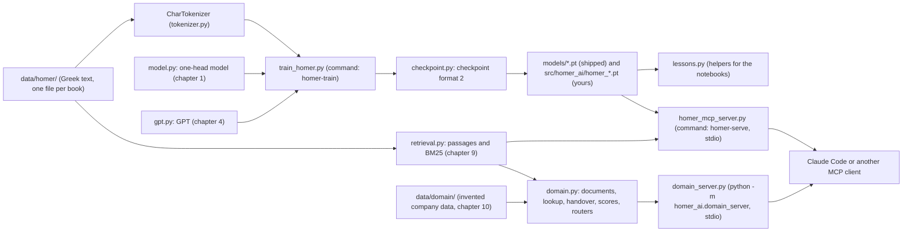

# Architecture

How the project fits together, for people who read or change the code. If you're here to learn, you want the [README](../README.md) instead.

homer-ai is a course (notebooks) and a small library (`src/homer_ai/`) that build a character-level language model on Homer's Greek. The course text is generated by `scripts/build_notebooks.py` from the small package `scripts/course/` (one module per chapter). The library tokenizes the Greek text, defines two models (a one-head model and a GPT), trains them on a laptop CPU, saves them in one checkpoint format, and serves them to other apps over MCP (Model Context Protocol, a standard way for an AI app to call a tool). The same server also offers a word search over both poems, so an app can answer questions from the real text (chapter 9). Chapter 10 adds a second, separate MCP server over invented company data, with its own module and its own data folder. Two small trained models ship in `models/`, so everything works before you've trained your own.

## What is the pipeline?

Read it left to right. The text becomes numbers, and a model learns to guess the next letter from those numbers. The weights get saved along with everything needed to use them. Then two things read that saved file: the notebooks and the MCP server. The search of chapter 9 is a second, shorter path: it reads the text files directly (Greek and English), trains nothing, and reaches the same server. Chapter 10 is a third path, apart from Homer: `domain.py` reads the invented files in `data/domain/`, reuses the `BM25` class of the search, and is served by its own server.

## Where do things live?

| File | Its job | Used by |
|---|---|---|
| `src/homer_ai/tokenizer.py` | `CharTokenizer`: one token per character, plus `<\|unk\|>` and `<\|endoftext\|>` | models, training, checkpoints, server, notebooks 02 onwards |
| `src/homer_ai/model.py` | `HomerGreekLLM`, the one-head model of chapter 1 (takes one text as a 1-D list of IDs) | training (`--model char`), checkpoints, notebooks |
| `src/homer_ai/gpt.py` | `GPTConfig` and `GPTModel`, the GPT of chapter 4 (takes a batch of texts) | training (`--model gpt`), checkpoints, notebooks |
| `src/homer_ai/generation.py` | `next_scores`: one next-letter step that works for both models | lessons, MCP server |
| `src/homer_ai/checkpoint.py` | save and load checkpoints (formats 1 and 2); `weights_only=True` | training, lessons, MCP server, tests |
| `src/homer_ai/train_homer.py` | the training loops and the `homer-train` command | CLI, lessons (constants and `load_books`), tests |
| `src/homer_ai/homer_mcp_server.py` | the MCP server with two tools: `consult_homer_llm` (the model continues a Greek seed) and `search_homer` (real passages with `poem book:line`); the `homer-serve` command | CLI, Claude Code and other MCP clients, notebooks 06_03 and 09_03 |
| `src/homer_ai/retrieval.py` | the search of chapter 9, standard library only: `load_passages` (passages that never cross a book), `tokenize`, `BM25`, `search` (index built on first use and kept in memory), and the scores `first_hit_rank` and `retrieval_scores` (recall@k, MRR) | MCP server, notebooks 09_01 to 09_04, `scripts/benchmark_grounding.py`, tests |
| `data/eval/questions.jsonl` | 40 labelled questions (20 per poem): the question, a short answer, and the places that answer it as `[book, first line, last line]` of the English files | `retrieval.load_questions`, notebooks 09_02 and 09_04, the benchmark, tests |
| `src/homer_ai/domain.py` | chapter 10; it loads no model (only `encode_emails` builds tensors, for 10_02): product sheets cut into versioned sections, `search_terms`, the exact lookup `get_rate`, `escalate` and the word-list guard `needs_person`, `audit_line` and `data_fingerprint`; the email labels and the baseline `keyword_flags`; the scores `recall`, `precision`, `f1`, `macro_f1`, `confusion`; `suggest_articles`, `TicketRouter` and `ProfileRouter` for the service desk | `domain_server.py`, notebooks 10_00 to 10_04, `scripts/benchmark_domain.py`, tests |
| `src/homer_ai/domain_server.py` | a second MCP server (`uv run python -m homer_ai.domain_server`, stdio) with three tools over the invented savings data: `search_terms`, `get_rate`, `escalate`; one audit line per call to stderr, and to the file named by `$HOMER_DOMAIN_AUDIT` | Claude Code and other MCP clients, notebook 10_01, `scripts/benchmark_domain.py`, tests |
| `data/domain/` | invented company data ([its README](../data/domain/README.md)): `savings/` (4 product sheets, a FAQ, `rates.csv`, 39 labelled questions), `emails/` (400 generated and 24 handwritten emails, labelled complaint and vulnerable), `servicedesk/` (10 articles, 200 generated tickets) | `domain.py`, chapter 10, tests |
| `src/homer_ai/lessons.py` | helpers the notebooks share (load the ready-made model, `fit`, `write`, `evaluate`, `tiny_train`), so each notebook shows only its own idea | notebooks, `scripts/baselines.py`, tests |
| `src/homer_ai/pretrained.py` | download and check GPT-2 small (to `~/.cache/homer-ai/`, or `$HOMER_CACHE`), read its safetensors file with plain Python, map its names onto `GPTModel` (`load_gpt2`) | notebooks 08_00 to 08_04, tests |
| `src/homer_ai/finetune.py` | the SMS spam data (download, balance, split, pad), the classification head, freezing, the training loop and accuracy | notebooks 08_02 and 08_04, tests |
| `src/homer_ai/lora.py` | `LoRALinear`, `apply_lora`, `count_parameters` | notebook 08_04, tests |
| `src/homer_ai/studio_style.py` | the colours and drawing helpers for every graph | notebooks, `scripts/export_diagrams.py` |
| `scripts/build_notebooks.py` | the entry point: runs the `scripts/course/` modules in order and writes every notebook and chapter README | authors, CI |
| `scripts/course/chNN_*.py`, `appendix_a_toolbox.py` | the text and code cells of each chapter (the single source); chapter N is `chNN_*.py` | `build_notebooks.py` |
| `scripts/course/cells.py` | the cell helpers (`md`, `code`, `title`, `questions`, ...) and `save()`, which writes one notebook | the chapter modules |
| `scripts/course/setup_code.py` | code cells shared by several notebooks of a chapter | the chapter modules |
| `scripts/course/diagrams.py` | the `DIAGRAM_*` drawing code and the `DIAGRAMS` list (file names, alt texts) | the chapter modules, `readmes.py`, `export_diagrams.py` |
| `scripts/course/readmes.py` | the facts of each chapter README, and the code that writes it | `build_notebooks.py` |
| `scripts/course/template.py` | the blank notebook template | `build_notebooks.py` |
| `scripts/export_diagrams.py` | draws the `DIAGRAM_*` code of `scripts/course/diagrams.py` to `docs/images/*.png` | authors, CI |
| `scripts/run_notebooks.py` | runs every notebook top to bottom in a real kernel; exits 1 on any failure. With `HOMER_SKIP_DOWNLOADS=1` it only checks the format of the notebooks that need a big download (08_01 to 08_04, and 10_02). It also checks every "Your turn" exercise: left blank, each check must print only ⏳; with `--solutions` it swaps in each folded solution and requires ✅ | authors, CI |
| `scripts/check_links.py` | checks that every relative link in the READMEs, `docs/*.md` and notebooks points at a file | authors, CI |
| `scripts/benchmark_grounding.py` | asks Claude the labelled questions twice through `claude -p`, plain and with the retrieved passages, and scores the cited book and line; run by hand, never by CI | authors, notebook 09_04 |
| `scripts/make_domain_data.py` | writes `data/domain/emails/emails.jsonl` and `data/domain/servicedesk/tickets.jsonl` from sentence lists and a seed (the same seed gives the same bytes); `--check` compares without writing | authors, tests |
| `scripts/benchmark_domain.py` | asks Claude the 39 support questions twice through `claude -p`, with no tools and with the chapter 10 MCP server connected, and scores answers, sources and handovers; run by hand, never by CI | authors, notebook 10_01 |
| `scripts/baselines.py` | measures the numbers of the README table; trains nothing, writes nothing | authors, README table |
| `scripts/corpus/` | `download.py`, `build.py`, `check.py`: build and check `data/homer/` | authors (see `data/homer/README.md`) |
| `scripts/templates/00_template.ipynb` | blank notebook for new ones (also generated) | authors |
| `tests/` | pytest tests of `src/homer_ai/`, including the chapter 8 helpers (these never download), the chapter 9 search and its labelled questions, and the chapter 10 tools, data, generator and server | CI |

## How is the course text built, and what does CI check?

`scripts/build_notebooks.py` runs the modules of `scripts/course/` in order (the template, chapters 0 to 10 with the toolbox appendix, then the chapter READMEs); together they hold all notebook and README text. It's deterministic, so building twice gives identical files. `scripts/export_diagrams.py` then draws the diagrams defined in `scripts/course/diagrams.py` into `docs/images/`, with a fixed font and no metadata, so its output is identical too.

CI ([.github/workflows/ci.yml](../.github/workflows/ci.yml)) runs on every push and pull request, on Ubuntu, in this order:

1. `uv sync --locked` (fails if `uv.lock` is out of date)
2. `uv run ruff check` and `uv run ruff format --check`
3. `uv run pytest`
4. build the notebooks twice, then `git diff --exit-code` (nothing may change)
5. `HOMER_SKIP_DOWNLOADS=1 uv run python scripts/run_notebooks.py` (every notebook runs, except 08_01 to 08_04 and 10_02, which need GPT-2's 548 MB file; those are only checked for a valid format)
6. `HOMER_SKIP_DOWNLOADS=1 uv run python scripts/run_notebooks.py --solutions` (every exercise solution must get ✅)
7. `uv run python scripts/check_links.py`
8. `uv run python scripts/export_diagrams.py --check` (the diagrams match `docs/images/`, allowing tiny pixel differences between operating systems)

The optional pre-commit hook (`.pre-commit-config.yaml`) runs Ruff and the rebuild locally. See [CONTRIBUTING.md](../CONTRIBUTING.md) for the commands and the style rules.

## What is inside a checkpoint?

`checkpoint.save_checkpoint` writes one file with `torch.save`. Format 2 holds:

| Field | Meaning |
|---|---|
| `format` | `2` |
| `kind` | `"char-1head"` (`model.py`) or `"gpt"` (`gpt.py`) |
| `config` | the sizes needed to rebuild the model (a dict) |
| `chars` | the vocabulary in order, special tokens included, so the tokenizer is rebuilt with the same IDs |
| `model_state` | the weights |
| `train_meta` | `git_sha`, `torch_version`, then what training passed in: seed, epochs, learning rate, losses, books, poem and so on |

Format 1 (the shipped `models/odyssey_book1.pt`) holds only `model_state` and `rhapsody_text`; the small model's tokenizer is rebuilt from that text and `embed_dim` is taken as 32. `load_checkpoint` reads both formats, puts the model in `eval()` mode, and loads with `weights_only=True`, so opening a file cannot run code. Format 2 saves the book names, not the text; `training_text` reads the books again from `data/homer/`.

## Which model file is used?

The notebooks prefer your own file: for the GPT, `src/homer_ai/homer_gpt.pt`, else `models/odyssey_book1_gpt.pt`; for the small model, `src/homer_ai/homer_model.pt`, else `models/odyssey_book1.pt`.

The MCP server (`find_model_file` in `homer_mcp_server.py`) takes the first of these that exists:

1. the file named by the environment variable `HOMER_MODEL` (if it is set but the file is missing, the server stops with an error rather than falling back)
2. `src/homer_ai/homer_gpt.pt` (your GPT)
3. `models/odyssey_book1_gpt.pt` (shipped GPT)
4. `src/homer_ai/homer_model.pt` (your small model)
5. `models/odyssey_book1.pt` (shipped small model)

If none exists, it stops with a message on how to train. `*.pt` files are git-ignored except `/models/*.pt` ([ADR 0003](decisions/0003-ship-small-models-in-git.md)).

## What can I rely on when I rerun things?

- **Seeds.** `homer-train` calls `torch.manual_seed(42)` for both models. The notebooks' `fit` takes a seed argument.
- **Pinned libraries.** `uv.lock` is committed, `.python-version` is 3.12, and CI installs with `--locked`.
- **CPU-only PyTorch on Linux.** `pyproject.toml` sends `torch` to the CPU index (`https://download.pytorch.org/whl/cpu`) when `sys_platform == 'linux'`, to avoid the multi-gigabyte CUDA build. macOS and Windows wheels from PyPI are CPU already.
- **No promise of identical weights.** [models/README.md](../models/README.md) only says the run is seeded, so you should get the same numbers on the same machine and PyTorch version, and other machines may differ in the last digits. We don't claim bit-identical retraining, and CI doesn't rebuild the shipped models.
- **Identical course files.** This part *is* guaranteed, and CI checks it: building the notebooks and the diagrams twice gives identical files.

## Security notes for the MCP server

- **stdio only.** `mcp.run()` is called with the default transport, `stdio`: the client starts the server as a child process and talks to it over stdin and stdout. It opens no network port.
- **No network use.** The server code reads local files and makes no network calls. (Notebook 07_05 downloads GPT-2's vocabulary once through `tiktoken`, and chapter 8 downloads GPT-2's weights; those are notebooks, not the server.)
- **Logs go to stderr.** stdout is the channel to the client, so one stray `print` would corrupt the protocol. Each call logs seed length, characters asked for, milliseconds, model file name and kind, never the seed text itself. A search logs the question's length, the poem, the language, `k`, how many passages it found and the milliseconds, never the question.
- **Input clamp.** `chars_to_generate` is clamped to 1 to 200 (`clamp_chars`); out-of-range values are fixed, not rejected. The reference lines are capped at 10. For `search_homer`, `k` is clamped to 1 to 10 (`clamp_k`), `poem` and `language` accept only their listed values, and a passage longer than 1,200 characters is cut.
- **Fast start.** The search index is not built at startup. The first `search_homer` call builds it (about a quarter of a second for both poems in English) and later calls reuse it.
- **Read-only model files.** Checkpoints are loaded with `weights_only=True`; the server never writes a model file.
- **Honest tool descriptions.** The text of `search_homer` says that it matches words and not meaning, that Butler's English uses Roman names, and that the line numbers are lines of this project's files. The text of `consult_homer_llm` says the output looks like Greek but is often not real Greek, that the tool cannot answer questions or explain grammar, and that the model is small and trained on Book 1 only. Clients show this to the model that decides whether to call the tool.
- **Unknown characters** in the seed become `<|unk|>`; they do not crash the call.

## Security notes for the chapter 10 server

`domain_server.py` is a separate server on purpose: an app that helps with savings questions sees three tools and nothing of Homer.

- **stdio only, no network use, no model file.** It starts without one, and reads only the invented data.
- **Invented data only.** That data is `data/domain/savings/`. The tool descriptions say that the firm is invented.
- **Small powers.** The tools read a section, read a rate, or return a handover record. `escalate` sends nothing anywhere. No tool writes to the data.
- **Closed lists.** `product` and `reason` are `Literal` types, so a client sees an `enum` and other values are refused. `k` is clamped to 1 to 5. A date that isn't `YYYY-MM-DD`, or one before the first rate, gets a plain "No rate" text and never a guess.
- **An audit line per call.** Time (UTC), tool, a fingerprint of the sheets and the rates table, and what came back (references, the rate row, the queue). The customer's words are not logged, only their length. The line goes to stderr, and is appended to the file in `$HOMER_DOMAIN_AUDIT` if that is set; the server writes nowhere else.
- **Tool results are untrusted text to the model.** Notebook 10_04 shows a planted instruction being retrieved like any other section. The sheets here are files in the repository; a deployment has to control who can write to what is indexed.

## Decisions

Why the project is shaped like this is in [docs/decisions/](decisions/README.md). To change the course or the code, read [CONTRIBUTING.md](../CONTRIBUTING.md).
