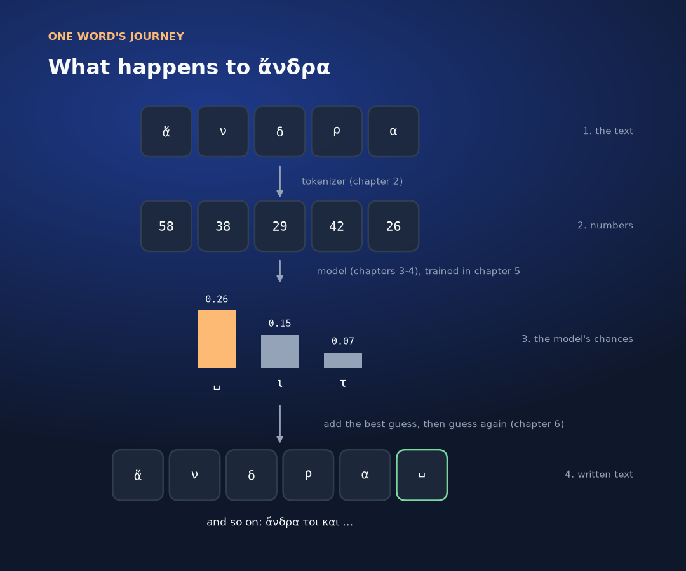

# Start here

## ❓ Why does this chapter matter?

Start here. Three short pages get you ready: a map of the whole course, setting up your computer, and reading an error message.

Where we're heading is three models, one after the other:

```
 Odyssey model  →  Iliad model  →  combine both
 (chapters 1-6)    (same steps)    (chapter 7)
```

## ❓ What will I learn?

- What we're building, and the order of the chapters
- How to set up the project and run a notebook
- How to read an error message

## ❓ Which new words will I meet?

| Word | Meaning in plain English | Example |
|---|---|---|
| **notebook** | a file of small boxes (cells) with code or notes; you run one cell and see the result under it | `00_00_course_map.ipynb` |
| **kernel** | the Python that runs your notebook's cells | the one in `.venv` |
| **traceback** | the message Python prints when it stops on an error; read its last line first | `NameError: name 'epochs' is not defined` |

## ❓ What will I see?



*Drawn in [00_00_course_map.ipynb](00_00_course_map.ipynb).*

## ❓ Which notebook do I open first?

Open them in this order.

| Notebook | What it teaches |
|---|---|
| [00_00_course_map.ipynb](00_00_course_map.ipynb) | The whole course on one page: what we build, the chapters, and how an LLM can use a tool |
| [00_01_setup.ipynb](00_01_setup.ipynb) | Terminal, VS Code, git, uv, the kernel, and a cell that checks your setup |
| [00_02_reading_errors.ipynb](00_02_reading_errors.ipynb) | How to read an error, using the real ones we hit while building this project |

## ❓ What should I know before I start?

Nothing at all. This is where it starts.

## ❓ Where is this in the project code?

- `pyproject.toml`: the shopping list of everything `uv sync` installs

## ❓ What do other learners ask?

**Do I need to know Python?**  
Not really, but you do need to be a developer in some language. We explain the AI and the PyTorch, not general Python. If Python is new to you, [A_01](../A_toolbox/A_01_python_essentials.ipynb) is an optional primer.

**Can I break anything?**  
No. The notebooks only read the text and run short demos. They never change the code or the trained models.

## ❓ Do I need the book?

No. This chapter is our own; it isn't in the book.
