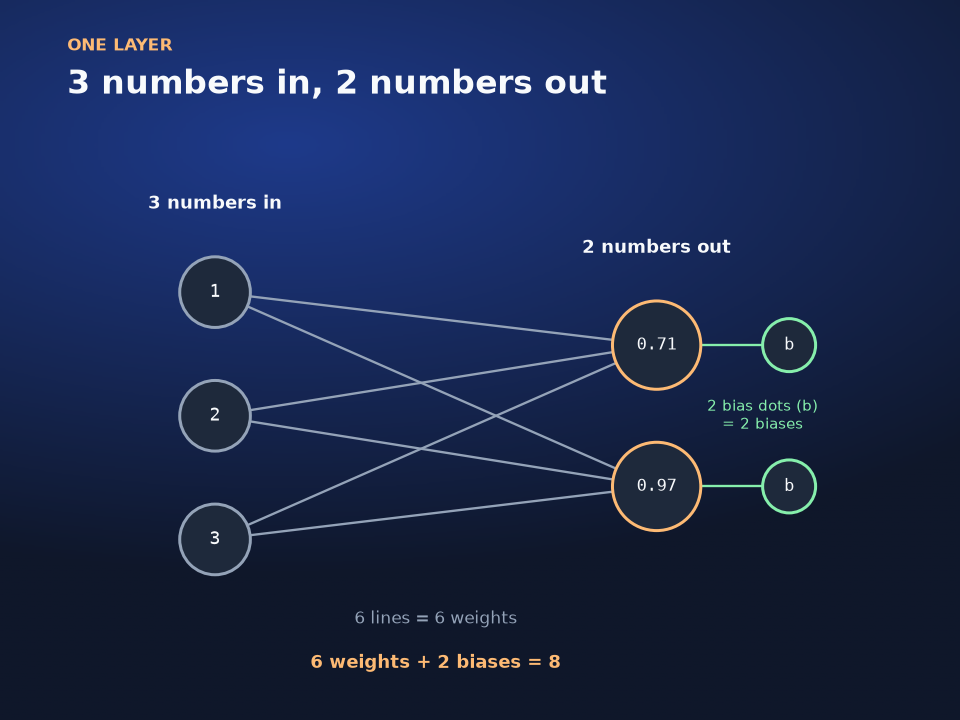

# Chapter 1: Foundations

## ❓ Why does this chapter matter?

Before we build a language model, there are four ideas you need, because every later chapter uses them: what a language model is, what a neural network is, how a program learns, and what our own model does when you look at it from the outside.

It's a bit like learning what bricks, floors and stairs are before you build a house. There's a picture of this in [docs/neural-network-building.html](../../docs/neural-network-building.html) (GitHub shows HTML as text: open the file locally in your browser).

The theory, the new words and other learners' questions live in the overview notebook, [01_00_chapter_overview.ipynb](01_00_chapter_overview.ipynb).

## ❓ What will I see?

*Drawn in [01_02_neural_networks.ipynb](01_02_neural_networks.ipynb).*

## ❓ Which notebook do I open first?

Open them in this order.

| Notebook | What it teaches |
|---|---|
| [01_00_chapter_overview.ipynb](01_00_chapter_overview.ipynb) | The big ideas of the chapter, in plain words |
| [01_01_a_language_model_without_a_brain.ipynb](01_01_a_language_model_without_a_brain.ipynb) | Counting which character follows which, and writing Greek with it |
| [01_02_neural_networks.ipynb](01_02_neural_networks.ipynb) | Layers, weights, and the floors of our model |
| [01_03_how_a_program_learns.ipynb](01_03_how_a_program_learns.ipynb) | Guess, mistake score, adjust, repeat: one weight by hand, then with PyTorch |
| [01_04_our_model_as_a_black_box.ipynb](01_04_our_model_as_a_black_box.ipynb) | What our model writes, untrained and trained |

## ❓ What should I know before I start?

[00_start_here](../00_start_here/): set up first with [00_01](../00_start_here/00_01_setup.ipynb). New to Python? See [A_01](../A_toolbox/A_01_python_essentials.ipynb). New to tensors? See [A_02](../A_toolbox/A_02_pytorch_tensors.ipynb).

## ❓ Where is this in the project code?

- `src/homer_ai/model.py`: the model's design: its layers and weights
- `src/homer_ai/train_homer.py`: `train()`: the learning loop
- `src/homer_ai/homer_model.pt`: the trained model (made by training; not stored in git)

## ❓ Do I need the book?

No, everything is explained here. If you do have it, this chapter matches Ch 1 and Appendix A (Introduction to PyTorch).
