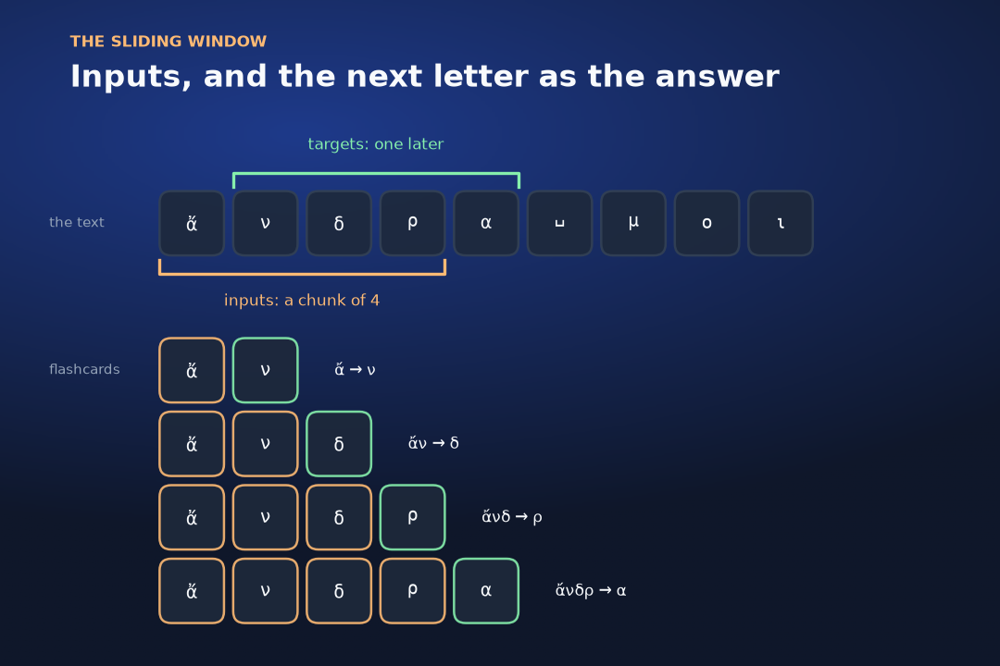
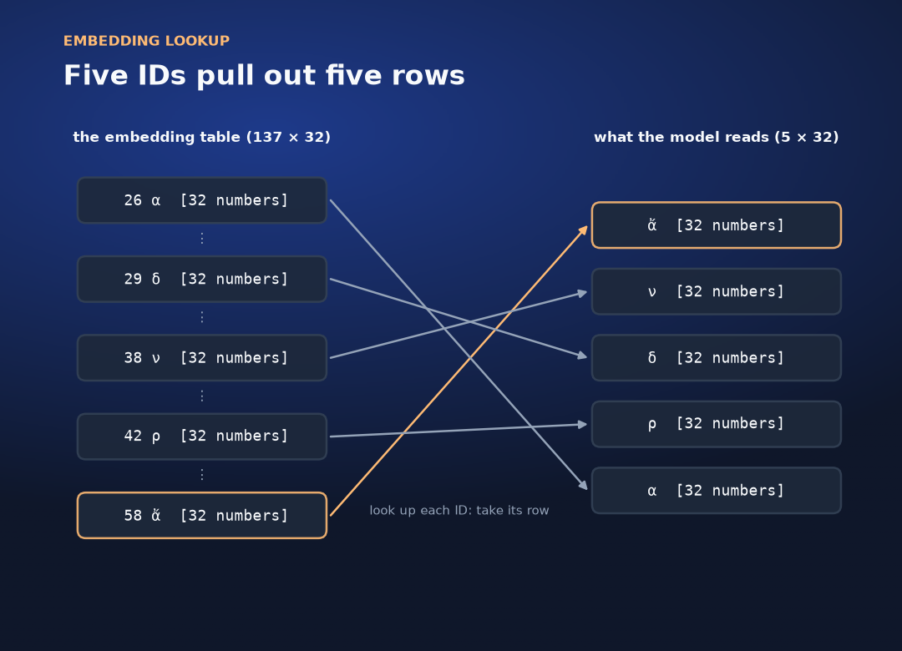

# Chapter 2: Text to numbers

## ❓ Where does this chapter fit?

```
Odyssey text → [numbers] → model reads → model learns → model writes → MCP tool
```

## ❓ Why does this chapter matter?

A model can only do maths, so it can't read Greek letters. In this chapter we turn the Odyssey into numbers, and those numbers are all the model will ever see.

Get this step wrong (say, letters quietly thrown away) and the model learns from the wrong text. No amount of training fixes that.

The theory, the new words and other learners' questions live in the overview notebook, [02_00_chapter_overview.ipynb](02_00_chapter_overview.ipynb).

## ❓ What will I see?



*Drawn in [02_04_sliding_window.ipynb](02_04_sliding_window.ipynb).*



*Drawn in [02_05_token_embeddings.ipynb](02_05_token_embeddings.ipynb).*

## ❓ Which notebook do I open first?

Open them in this order.

| Notebook | What it teaches |
|---|---|
| [02_00_chapter_overview.ipynb](02_00_chapter_overview.ipynb) | The ideas of the whole chapter, in plain words |
| [02_01_tokens_and_vocabulary.ipynb](02_01_tokens_and_vocabulary.ipynb) | Character tokens, the vocabulary, encode and decode (book 2.2 + 2.3) |
| [02_02_special_tokens.ipynb](02_02_special_tokens.ipynb) | `<\|unk\|>` for unknown letters, `<\|endoftext\|>` between books |
| [02_03_bpe.ipynb](02_03_bpe.ipynb) | How BPE builds its vocabulary by counting |
| [02_04_sliding_window.ipynb](02_04_sliding_window.ipynb) | Cutting the text into practice pieces for the model |
| [02_05_token_embeddings.ipynb](02_05_token_embeddings.ipynb) | Turning each token number into a list of numbers that can carry meaning |
| [02_06_positions.ipynb](02_06_positions.ipynb) | Telling the model where each token sits in the line |

## ❓ What should I know before I start?

[01_foundations](../01_foundations/). New to tensors? See [A_02](../A_toolbox/A_02_pytorch_tensors.ipynb). New to Python? See [A_01](../A_toolbox/A_01_python_essentials.ipynb).

## ❓ Where is this in the project code?

- `src/homer_ai/tokenizer.py`: `CharTokenizer`: text → numbers and back, with the special tokens
- `src/homer_ai/train_homer.py`: `load_books` and `load_data`: read the books and put `<|endoftext|>` between them

## ❓ Do I need the book?

No, everything is explained here. If you do have it, this chapter matches Ch 2 (Working with text data).
