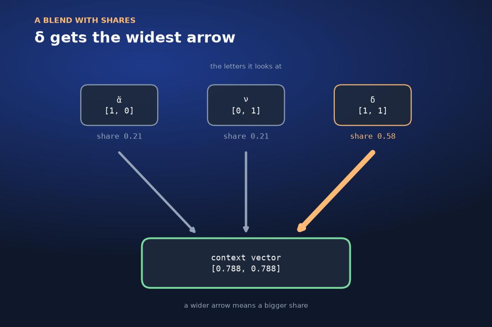
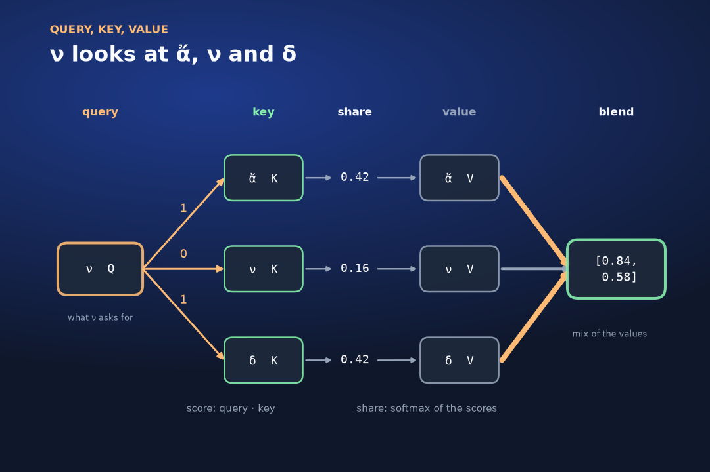

# Chapter 3: Attention

## ❓ Where does this chapter fit?

```
Odyssey text → numbers → [model reads] → model learns → model writes → MCP tool
```

## ❓ Why does this chapter matter?

To guess the next letter well, the model has to know which earlier letters matter most. In `πολλὰ`, the letters just before matter a lot, and a word ten verses back matters much less. **Attention** is how the model decides.

You'll find it at the centre of every modern language model.

The theory, the new words and other learners' questions live in the overview notebook, [03_00_chapter_overview.ipynb](03_00_chapter_overview.ipynb).

## ❓ What will I see?



*Drawn in [03_01_simple_attention.ipynb](03_01_simple_attention.ipynb).*



*Drawn in [03_02_trainable_attention.ipynb](03_02_trainable_attention.ipynb).*

## ❓ Which notebook do I open first?

Open them in this order.

| Notebook | What it teaches |
|---|---|
| [03_00_chapter_overview.ipynb](03_00_chapter_overview.ipynb) | The theory of attention: why the model looks back, and which letters matter |
| [03_01_simple_attention.ipynb](03_01_simple_attention.ipynb) | Scores, softmax and a weighted mix, with nothing to learn |
| [03_02_trainable_attention.ipynb](03_02_trainable_attention.ipynb) | Query, key and value: attention the model can learn, rebuilt from `model.py` |
| [03_03_hiding_the_future.ipynb](03_03_hiding_the_future.ipynb) | The causal mask: no peeking at later letters |
| [03_04_many_heads.ipynb](03_04_many_heads.ipynb) | Several attention heads at once (our `model.py` has one) |

## ❓ What should I know before I start?

[02_text_to_numbers](../02_text_to_numbers/), up to token embeddings. The maths of attention is the dot product: see [A_03](../A_toolbox/A_03_dot_product.ipynb).

## ❓ Where is this in the project code?

- `src/homer_ai/model.py`: the attention part of `HomerGreekLLM` (one simple head)

## ❓ Do I need the book?

No, everything is explained here. If you do have it, this chapter matches Ch 3 (Coding attention mechanisms).
