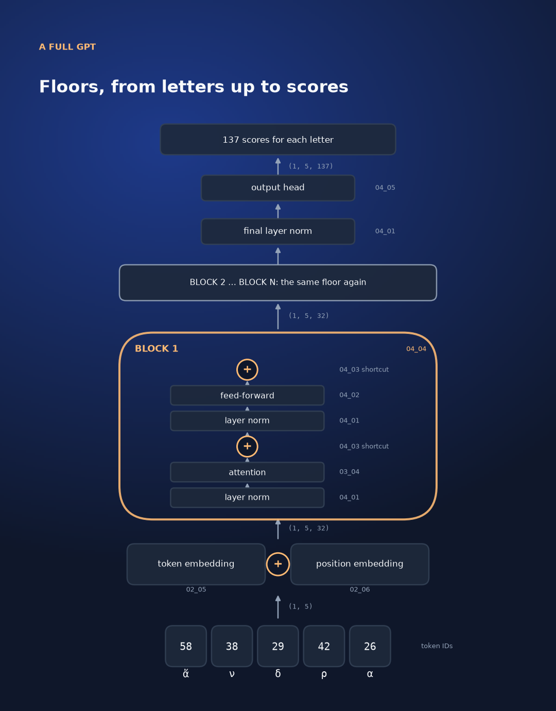
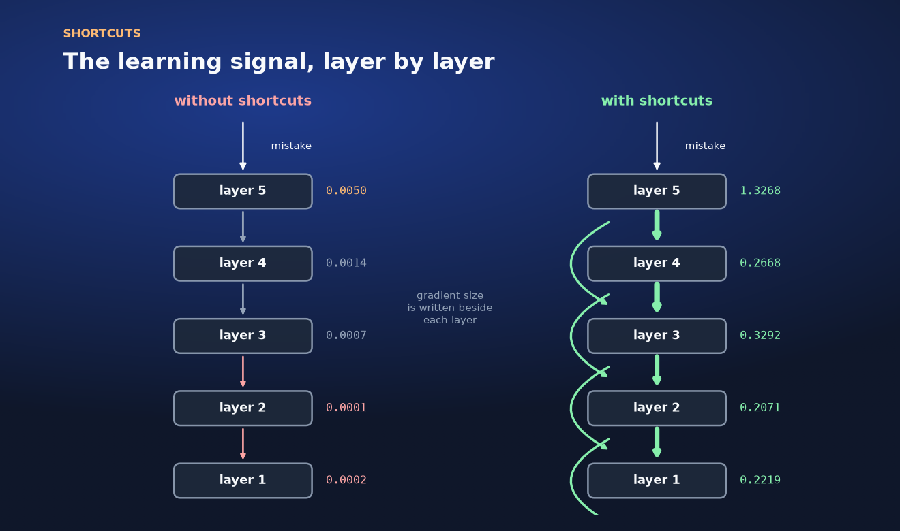
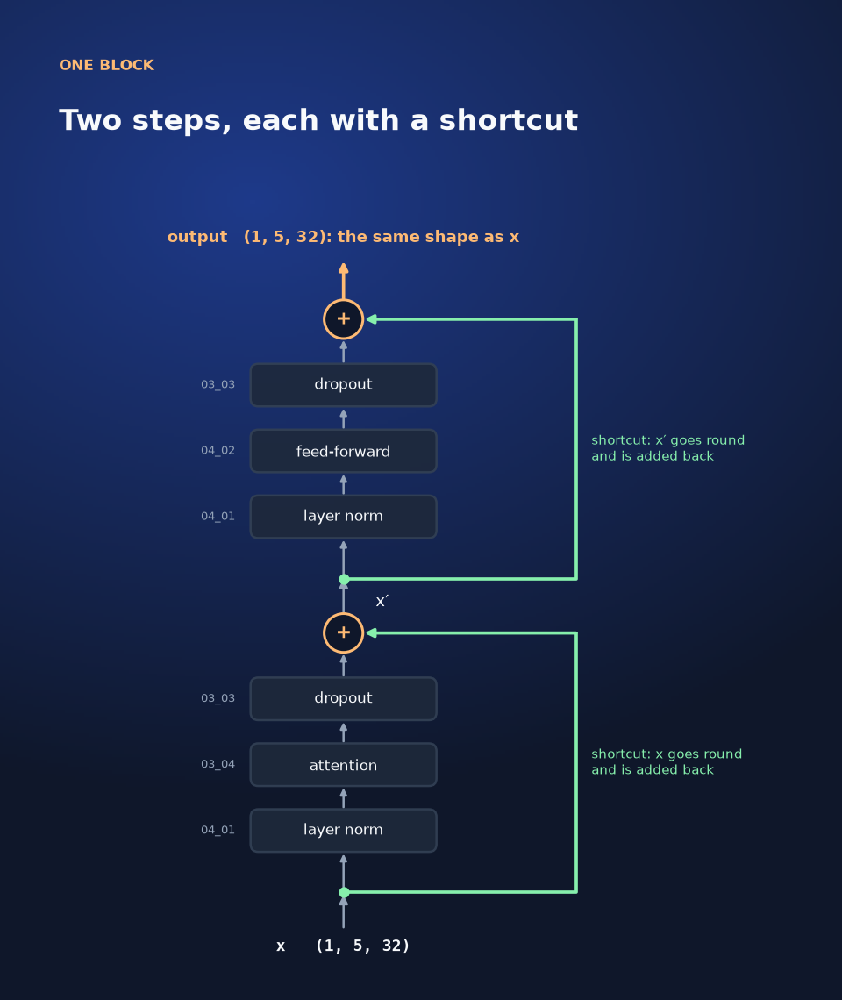

# Chapter 4: Building the model

## ❓ Where does this chapter fit?

```
Odyssey text → numbers → [model reads] → model learns → model writes → MCP tool
```

## ❓ Why does this chapter matter?

Attention alone isn't a full model. This chapter adds the other parts and stacks them into floors, like a building, to make a GPT-style model.

Our small model (`model.py`) has only one attention part and none of these extras. That's one reason its loss stops at about 2.4.

The theory, the new words and other learners' questions live in the overview notebook, [04_00_chapter_overview.ipynb](04_00_chapter_overview.ipynb).

## ❓ What will I see?



*Drawn in [04_00_chapter_overview.ipynb](04_00_chapter_overview.ipynb).*



*Drawn in [04_03_shortcuts.ipynb](04_03_shortcuts.ipynb).*



*Drawn in [04_04_one_block.ipynb](04_04_one_block.ipynb).*

## ❓ Which notebook do I open first?

Open them in this order.

| Notebook | What it teaches |
|---|---|
| [04_00_chapter_overview.ipynb](04_00_chapter_overview.ipynb) | The theory of the full model, and the config |
| [04_01_layer_norm.ipynb](04_01_layer_norm.ipynb) | Layer norm: keeping the numbers from drifting |
| [04_02_feed_forward.ipynb](04_02_feed_forward.ipynb) | The feed-forward step and the GELU curve |
| [04_03_shortcuts.ipynb](04_03_shortcuts.ipynb) | Shortcut connections: keeping the learning signal alive |
| [04_04_one_block.ipynb](04_04_one_block.ipynb) | Putting the parts into one block |
| [04_05_the_full_model.ipynb](04_05_the_full_model.ipynb) | Stacking blocks into the full model, and writing (untrained) letters |

## ❓ What should I know before I start?

[03_attention](../03_attention/)

## ❓ Where is this in the project code?

- `src/homer_ai/model.py`: `HomerGreekLLM`, the small one-head model we compare against
- `src/homer_ai/gpt.py`: `GPTModel`, the full model this chapter builds

## ❓ Do I need the book?

No, everything is explained here. If you do have it, this chapter matches Ch 4 (Implementing a GPT model from scratch).
