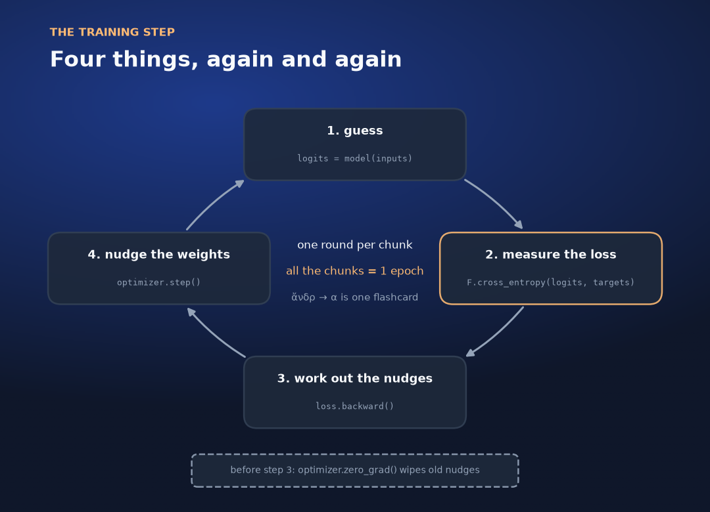

# Chapter 5: Training on the Odyssey

## ❓ Where does this chapter fit?

```
Odyssey text → numbers → model reads → [model learns] → model writes → MCP tool
```

## ❓ Why does this chapter matter?

A new model only makes random guesses. Training is how it gets better: it guesses the next letter, measures how wrong it was, and adjusts its weights, many thousands of times.

And how do you know it really **learned** patterns, and didn't just memorise the text? This chapter shows you how to check.

The theory, the new words and other learners' questions live in the overview notebook, [05_00_chapter_overview.ipynb](05_00_chapter_overview.ipynb).

## ❓ What will I see?



*Drawn in [05_00_chapter_overview.ipynb](05_00_chapter_overview.ipynb).*

## ❓ Which notebook do I open first?

Open them in this order.

| Notebook | What it teaches |
|---|---|
| [05_00_chapter_overview.ipynb](05_00_chapter_overview.ipynb) | The theory of training |
| [05_01_loss_and_epochs.ipynb](05_01_loss_and_epochs.ipynb) | Loss, epochs, and reading the loss curve |
| [05_02_learning_rate.ipynb](05_02_learning_rate.ipynb) | Step size, the trade-off, and the cosine schedule |
| [05_03_memorising_vs_understanding.ipynb](05_03_memorising_vs_understanding.ipynb) | Overfitting, and why we need hidden test text |
| [05_04_running_fair_experiments.ipynb](05_04_running_fair_experiments.ipynb) | Baseline, diff, fixed seed, one change at a time, timing, a results log |
| [05_05_validation.ipynb](05_05_validation.ipynb) | Splitting the text and measuring the validation loss |
| [05_06_saving_and_loading.ipynb](05_06_saving_and_loading.ipynb) | Saving the trained model to a file, and loading it again |
| [05_07_train_the_gpt.ipynb](05_07_train_the_gpt.ipynb) | The GPT's own training loop: random batches, weight decay, dropout, and the command to train yours |

## ❓ What should I know before I start?

[04_building_the_model](../04_building_the_model/). Most notebooks here use our small model (`model.py`), so they run in seconds. How PyTorch measures the loss and adjusts the weights: see [A_04](../A_toolbox/A_04_pytorch_in_this_repo.ipynb).

## ❓ Where is this in the project code?

- `src/homer_ai/train_homer.py`: `train()`: the small model's training loop, the learning rate and the schedule; `train_gpt()`: the GPT's loop (05_07)
- `src/homer_ai/homer_model.pt`: the trained model, saved after training (not stored in git)

## ❓ Do I need the book?

No, everything is explained here. If you do have it, this chapter matches Ch 5 (Pretraining on unlabeled data).
