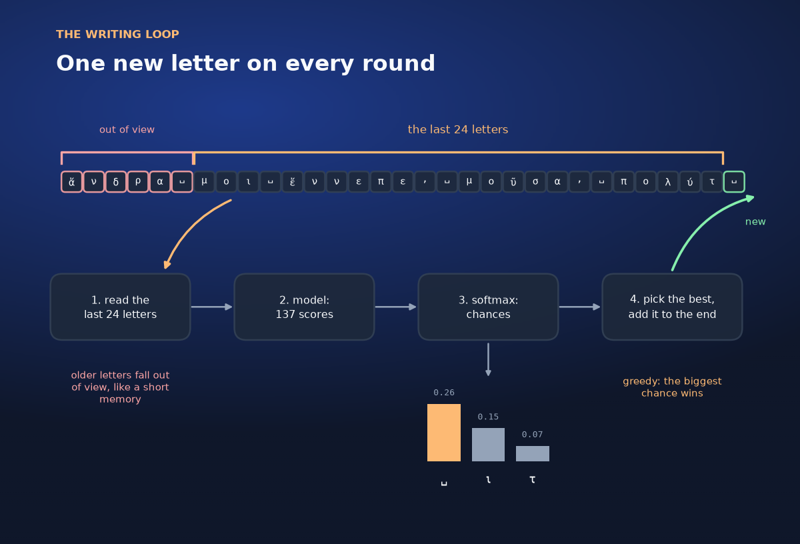
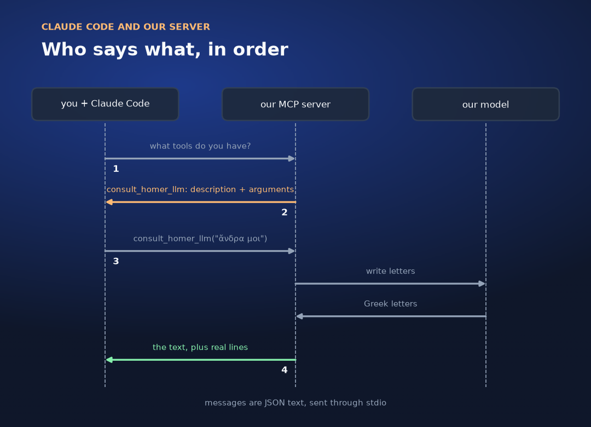

# Chapter 6: Making it talk

## ❓ Where does this chapter fit?

```
Odyssey text → numbers → model reads → model learns → [model writes] → MCP tool
```

## ❓ Why does this chapter matter?

A trained model is only useful if it can write. In this chapter we turn its guesses into new Greek text, one letter at a time. Then we let other AI apps, like Claude, ask it for text through MCP.

The theory, the new words and other learners' questions live in the overview notebook, [06_00_chapter_overview.ipynb](06_00_chapter_overview.ipynb).

## ❓ What will I see?



*Drawn in [06_01_writing_greek.ipynb](06_01_writing_greek.ipynb).*



*Drawn in [06_03_the_mcp_server.ipynb](06_03_the_mcp_server.ipynb).*

## ❓ Which notebook do I open first?

Open them in this order.

| Notebook | What it teaches |
|---|---|
| [06_00_chapter_overview.ipynb](06_00_chapter_overview.ipynb) | The theory: writing letter by letter, and MCP |
| [06_01_writing_greek.ipynb](06_01_writing_greek.ipynb) | Building `write()`, and why greedy writing loops |
| [06_02_less_repetition.ipynb](06_02_less_repetition.ipynb) | Temperature and top-k: choosing the next letter with some chance |
| [06_03_the_mcp_server.ipynb](06_03_the_mcp_server.ipynb) | How our MCP server works, and how to connect it to Claude Code |

## ❓ What should I know before I start?

[05_training_on_the_odyssey](../05_training_on_the_odyssey/), because you need a trained model. For uv, git and MCP, see [A_06](../A_toolbox/A_06_other_tools.ipynb).

## ❓ Where is this in the project code?

- `src/homer_ai/homer_mcp_server.py`: the MCP server: loads the model and offers it as a tool

## ❓ Do I need the book?

No, everything is explained here. If you do have it, this chapter matches Sections 4.7, 5.1.1 and 5.3 (text generation) and our own (MCP).
