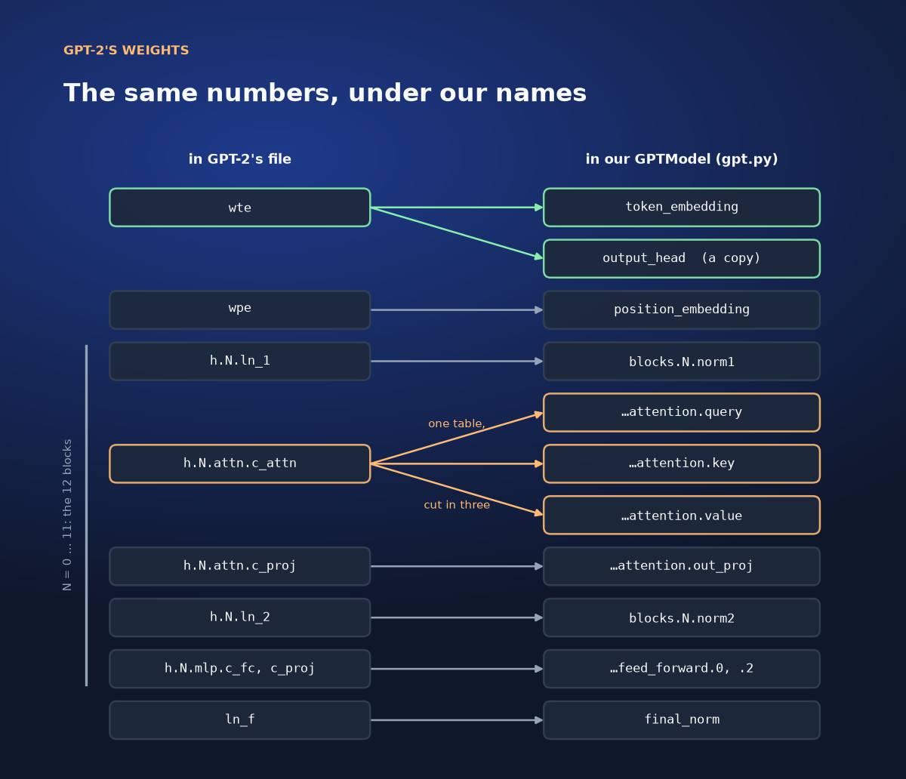
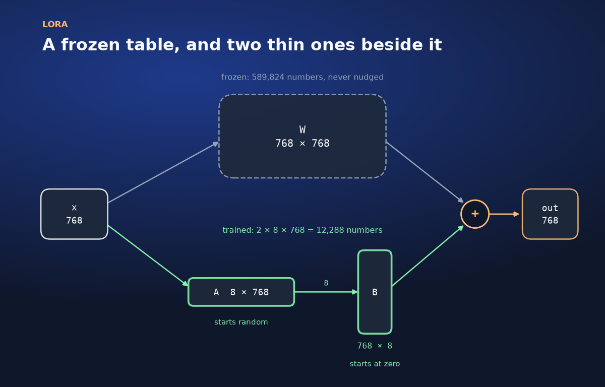

# Chapter 8: Advanced: fine-tuning a pretrained model

## ❓ Why does this chapter matter?

Chapters 1 to 7 built a model from nothing. In real work you rarely do that: you take a model somebody already trained and give it a short course for your job. That's **fine-tuning**.

Our Homer model is like a child we taught to babble Greek from scratch. GPT-2 is an adult who already speaks English. So here we borrow GPT-2 small, load its weights into the `GPTModel` you built in chapter 4, and teach it two jobs: sorting text messages into spam and not spam, and answering simple requests.

This chapter downloads GPT-2's weights once (548 MB) to `~/.cache/homer-ai/`, outside the project. Each notebook runs in a few minutes on a laptop CPU. The results are reported as they came: the spam filter works well, and instruction-following only partly.

The theory, the new words and other learners' questions live in the overview notebook, [08_00_chapter_overview.ipynb](08_00_chapter_overview.ipynb).

## ❓ What will I see?

*Drawn in [08_01_loading_gpt2.ipynb](08_01_loading_gpt2.ipynb).*

*Drawn in [08_04_lora.ipynb](08_04_lora.ipynb).*

## ❓ Which notebook do I open first?

Open them in this order.

| Notebook | What it teaches |
|---|---|
| [08_00_chapter_overview.ipynb](08_00_chapter_overview.ipynb) | The plan: prompt, RAG, fine-tune or from scratch; why we borrow GPT-2; what to expect |
| [08_01_loading_gpt2.ipynb](08_01_loading_gpt2.ipynb) | Read GPT-2's weights file by hand and pour it into our GPTModel, until it writes English |
| [08_02_spam_classifier.ipynb](08_02_spam_classifier.ipynb) | A new 2-score head, frozen layers, and a spam filter trained in about a minute |
| [08_03_instructions.ipynb](08_03_instructions.ipynb) | A small instruction set from Butler's Homer, and an honest look at what GPT-2 small learns |
| [08_04_lora.ipynb](08_04_lora.ipynb) | LoRA in 20 lines: the same spam filter with 5 times fewer trained numbers |

## ❓ What should I know before I start?

Chapters 4 to 6: the GPT ([04_05](../04_building_the_model/04_05_the_full_model.ipynb)), the training loop ([05_07](../05_training_on_the_odyssey/05_07_train_the_gpt.ipynb)) and writing text ([06_02](../06_making_it_talk/06_02_less_repetition.ipynb)). BPE tokens ([02_03](../02_text_to_numbers/02_03_bpe.ipynb)) help too. You need an internet connection for the first run, and about 2 GB of free memory.

## ❓ Where is this in the project code?

- `src/homer_ai/gpt.py`: `GPTModel`, the class GPT-2's weights are loaded into
- `src/homer_ai/pretrained.py`: download and check GPT-2, read the safetensors file, map the names (`load_gpt2`)
- `src/homer_ai/finetune.py`: the spam data, the classification head and the training loop
- `src/homer_ai/lora.py`: `LoRALinear` and `apply_lora`
- `tests/test_fine_tuning.py`: tests of those three files; they never download

## ❓ Do I need the book?

No, everything is explained here. If you do have it, this chapter matches section 5.5 (loading OpenAI's weights), chapter 6 (classification), chapter 7 (instructions) and appendix E (LoRA).
