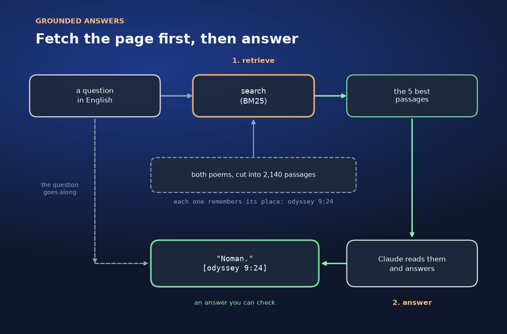
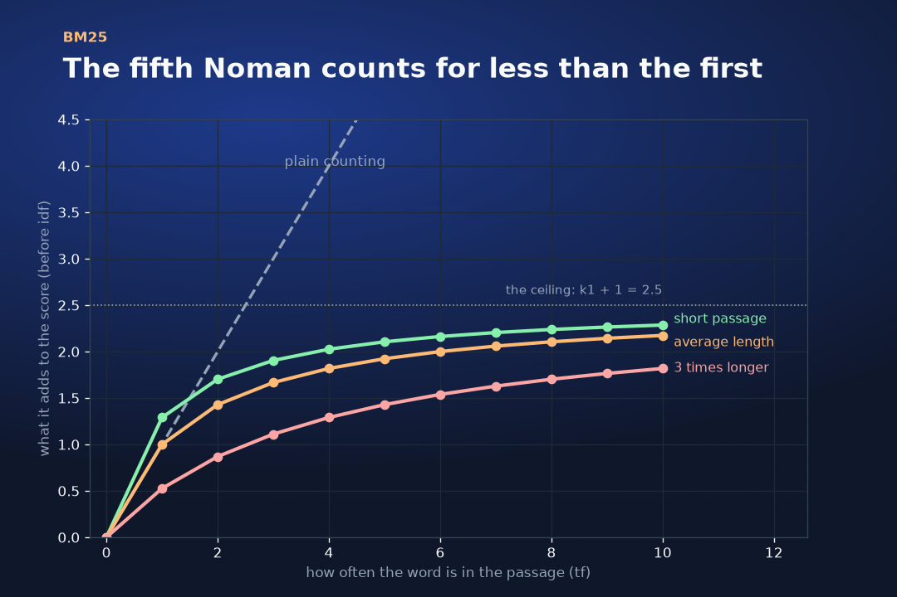

# Chapter 9: Advanced: answers grounded in Homer's text

## ❓ Why does this chapter matter?

Ask a language model about Homer and it answers from memory. It may well be right, but you can't see where the answer came from. This chapter builds the other way: a search fetches the passages that fit your question, the model answers from them, and the answer comes with the book and line, so you can check it. That's **RAG**, retrieval-augmented generation.

Think of a closed-book exam and an open-book one. Here a librarian fetches the right pages first, and you write the page number beside your answer. The librarian is a word search called BM25, which we build from scratch. The student is Claude, who reaches the search through a second tool on our MCP server.

Nothing is trained and nothing is downloaded. We measure the search on 40 labelled questions and report the numbers as they came: it finds a right passage in its first 5 for about half of them, and on a poem as famous as Homer's, Claude does very well from memory. What grounding adds is a line you can check.

The theory, the new words and other learners' questions live in the overview notebook, [09_00_chapter_overview.ipynb](09_00_chapter_overview.ipynb).

## ❓ What will I see?

*Drawn in [09_00_chapter_overview.ipynb](09_00_chapter_overview.ipynb).*

*Drawn in [09_01_chunking_and_bm25.ipynb](09_01_chunking_and_bm25.ipynb).*

## ❓ Which notebook do I open first?

Open them in this order.

| Notebook | What it teaches |
|---|---|
| [09_00_chapter_overview.ipynb](09_00_chapter_overview.ipynb) | The plan: an open-book exam for Claude, why our own model can't answer, what to expect |
| [09_01_chunking_and_bm25.ipynb](09_01_chunking_and_bm25.ipynb) | Passages with book and line, then bag of words, idf and BM25 by hand on three real passages |
| [09_02_search_and_scores.ipynb](09_02_search_and_scores.ipynb) | Both poems in one search, 40 labelled questions, recall@k and MRR, and two kinds of embeddings |
| [09_03_the_search_tool.ipynb](09_03_the_search_tool.ipynb) | `search_homer` on the MCP server, and the settings for Claude Code, Claude Desktop, Codex CLI, LM Studio and nanobot |
| [09_04_with_and_without.ipynb](09_04_with_and_without.ipynb) | Claude with and without the passages, an honest reading of the result, and the same parts in a company |

## ❓ What should I know before I start?

The MCP server of [06_03](../06_making_it_talk/06_03_the_mcp_server.ipynb), and the habit of measuring from [05_04](../05_training_on_the_odyssey/05_04_running_fair_experiments.ipynb). Embeddings ([02_05](../02_text_to_numbers/02_05_token_embeddings.ipynb)) and the dot product ([A_03](../A_toolbox/A_03_dot_product.ipynb)) help for one part of 09_02. Chapter 8 isn't needed.

## ❓ Where is this in the project code?

- `src/homer_ai/retrieval.py`: passages, `tokenize`, `BM25`, `search`, and the scores `recall@k` and MRR
- `src/homer_ai/homer_mcp_server.py`: the MCP server; `search_homer` is its second tool
- `data/eval/questions.jsonl`: 40 questions about the two poems, each with the book and lines that answer it
- `scripts/benchmark_grounding.py`: asks Claude the questions with and without the passages (run by hand, not by CI)
- `tests/test_retrieval.py`: tests of the search, the labelled questions and the scores

## ❓ Do I need the book?

No. This chapter is our own; it isn't in the book.
