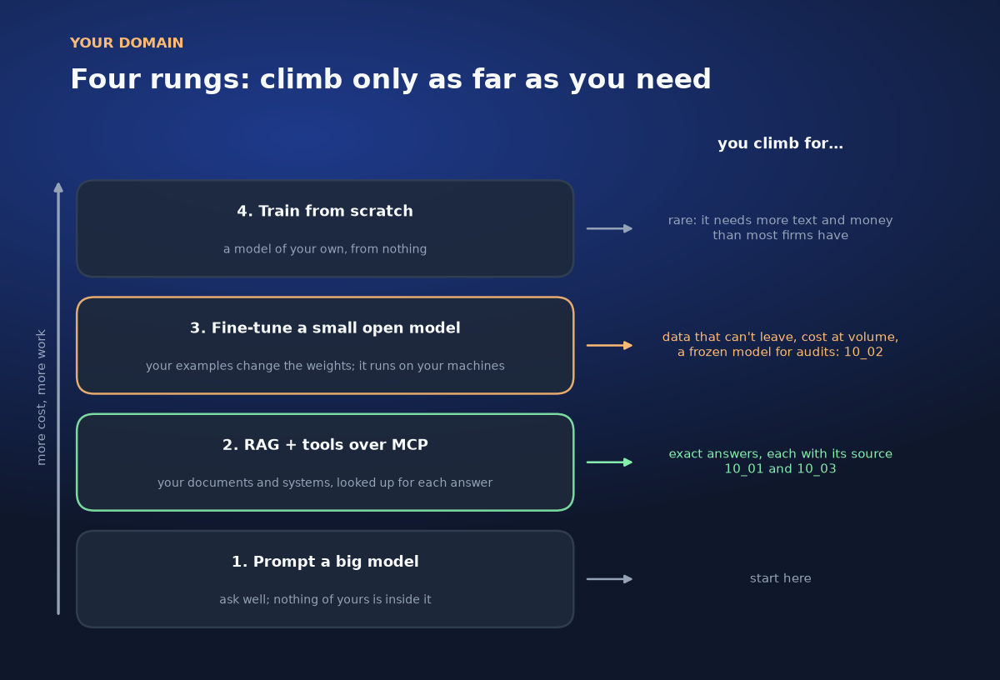
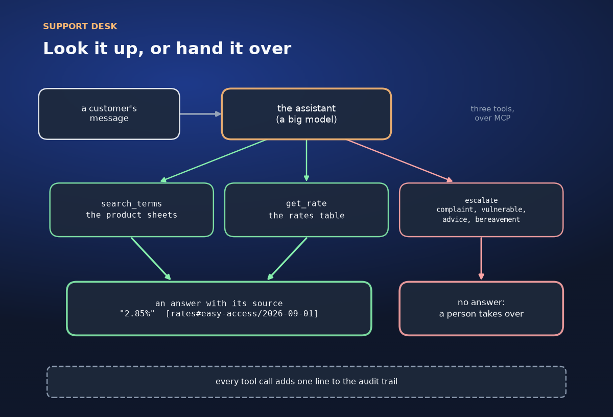

# Chapter 10: Advanced: your own domain

## ❓ Why does this chapter matter?

Why would a company want its own LLM? Mostly it doesn't mean training one. It means a model that answers from the firm's own documents, or a small one that runs on the firm's own machines. This chapter takes the course's pattern (your data, a tool, an MCP server, a score with and without) to that kind of work.

Think of four ways to get help with your paperwork: phone an outside expert, give that expert your binder and a few extensions to call, train a junior clerk for one job, or raise a child to do it. Those are the four rungs: prompt a big model, RAG and tools over MCP, fine-tune a small open model, train from scratch. Firms climb to the second and third for exact answers with a source, for data that can't leave, for cost at volume, and for a model that stays frozen. The fourth is rare.

There are three worked examples: a support assistant for a savings firm, a classifier that flags complaints and vulnerable customers in email, and triage for an IT service desk. **All the data is invented** ([data/domain/README.md](../../data/domain/README.md)), so the scores show how to measure, and say nothing about real mail. The last notebook lists what would make such demos look naive to the people who'd have to run them.

The theory, the new words and other learners' questions live in the overview notebook, [10_00_chapter_overview.ipynb](10_00_chapter_overview.ipynb).

## ❓ What will I see?

*Drawn in [10_00_chapter_overview.ipynb](10_00_chapter_overview.ipynb).*

*Drawn in [10_01_support_with_citations.ipynb](10_01_support_with_citations.ipynb).*

## ❓ Which notebook do I open first?

Open them in this order.

| Notebook | What it teaches |
|---|---|
| [10_00_chapter_overview.ipynb](10_00_chapter_overview.ipynb) | The ladder with the reasons a firm climbs it, the three examples, and the invented data |
| [10_01_support_with_citations.ipynb](10_01_support_with_citations.ipynb) | A savings firm's support desk: `search_terms`, `get_rate`, `escalate`, a second MCP server, and Claude with and without the tools |
| [10_02_spotting_complaints.ipynb](10_02_spotting_complaints.ipynb) | 400 emails, a keyword baseline, GPT-2 fine-tuned in under a minute, recall first, macro-F1, a threshold, and a reality check (needs GPT-2's 548 MB file) |
| [10_03_service_desk_triage.ipynb](10_03_service_desk_triage.ipynb) | 200 tickets and 10 articles: suggest the article, route the ticket, and see what boilerplate and a random split do to the score |
| [10_04_pitfalls_and_next_steps.ipynb](10_04_pitfalls_and_next_steps.ipynb) | Nine pitfalls, each tied to a place in the course, and where this goes next at work |

## ❓ What should I know before I start?

The search of [chapter 9](../09_advanced_grounded_answers/) (BM25, recall@k, the MCP tool) and the fine-tuning of [08_02](../08_advanced_fine_tuning/08_02_spam_classifier.ipynb). 10_01, 10_03 and 10_04 need no download. 10_02 uses GPT-2's weights from chapter 8.

## ❓ Where is this in the project code?

- `src/homer_ai/domain.py`: the documents, the tools (`search_terms`, `get_rate`, `escalate`), the guard, the scores (`recall`, `macro_f1`) and the ticket routers
- `src/homer_ai/domain_server.py`: a second MCP server with the three support tools and an audit trail (`uv run python -m homer_ai.domain_server`)
- `data/domain/`: the invented product sheets, rates, questions, emails, tickets and articles, with a README on how they were made
- `scripts/make_domain_data.py`: writes the emails and tickets from sentence lists and a seed; the same seed gives the same bytes
- `scripts/benchmark_domain.py`: asks Claude the support questions with and without the MCP tools (run by hand, not by CI)
- `tests/test_domain.py`: tests of the tools, the data, the generator, the scores and the server

## ❓ Do I need the book?

No. This chapter is our own; it isn't in the book.
